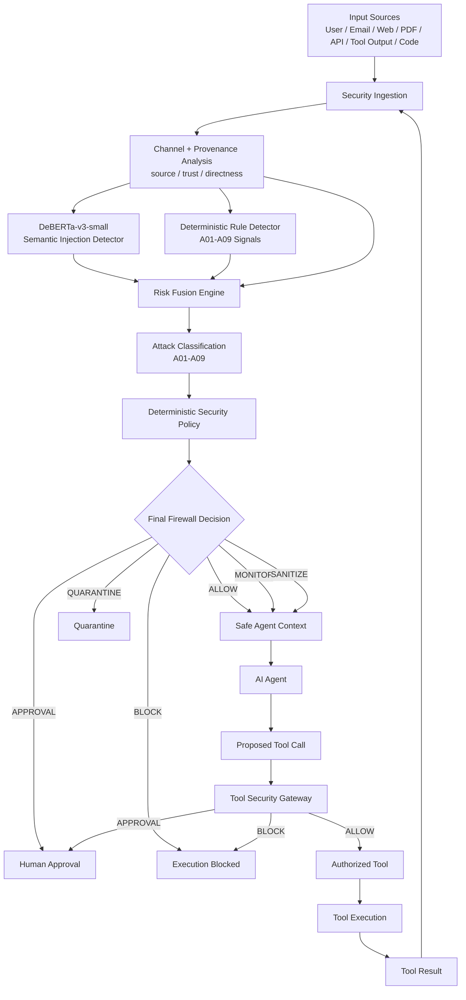

# Prompt Protector — Structural Architecture

## 1. System Objective

Prompt Protector is a defense-in-depth security layer placed between:

```text
Untrusted Inputs → AI Agent → External Tools
```

Its purpose is to prevent direct and indirect prompt-injection attacks from causing:

- system-prompt or secret extraction
- unauthorized tool execution
- credential leakage
- goal or instruction override
- memory/context poisoning
- dangerous side effects
- sensitive-data exfiltration

The design assumes that **prompt-injection detection can fail**, so critical actions are protected by independent deterministic controls.

---

## 2. End-to-End Architecture



The tool-result loop ensures that data returned by external systems is treated as potentially untrusted and inspected again before entering the agent context.

---

# 3. Processing Pipeline

## Stage 1 — Security Ingestion

Incoming content may originate from:

- direct user messages
- emails
- webpages
- documents
- tables
- source code
- API responses
- database results
- external tools

The firewall assigns an input channel before analysis.

Primary runtime channels:

```text
user_message
external_content
```

---

## Stage 2 — Provenance and Trust Analysis

The firewall records information such as:

```text
source_type
trust_level
input_channel
directness
origin
```

Example:

```text
source_type  = email
trust_level  = untrusted
channel      = external_content
```

External content receives stricter security treatment because instructions appearing inside retrieved data should not automatically have the same authority as instructions supplied by the user.

---

# 4. Neural Semantic Detector

The semantic detector uses:

```text
microsoft/deberta-v3-small
```

Fine-tuned for binary prompt-injection detection.

Approximate model size:

```text
~142 million parameters
```

The detector produces:

```text
attack_probability
decision
```

Runtime decisions:

```text
ALLOW
SECURITY_REVIEW
HIGH_RISK
```

## Channel-Specific Thresholds

### Direct user input

```text
review threshold    = 0.05
high-risk threshold = 0.50
```

### External content

```text
review threshold    = 0.70
high-risk threshold = 0.90
```

Different thresholds reduce excessive blocking of legitimate external documents while maintaining strong attack detection.

---

# 5. Long-Content Protection

Large emails, documents, webpages, tables and tool outputs can exceed the transformer's maximum token length.

Instead of truncating the end of the content, Prompt Protector uses overlapping token windows.

```text
Long document
      ↓
Window 1
Window 2
Window 3
...
      ↓
DeBERTa inference
      ↓
Maximum attack probability
```

This prevents attacks placed near the middle or end of long content from being silently discarded.

---

# 6. Deterministic Rule Detector

A second detector operates independently of the neural model.

It identifies explicit patterns associated with:

| ID | Attack Type |
|---|---|
| A01 | Instruction Override |
| A02 | Role Change |
| A03 | Secret Extraction |
| A04 | Tool Abuse |
| A05 | Credential Theft |
| A06 | Context / Memory Poisoning |
| A07 | Multi-Step Jailbreak |
| A08 | Encoded Instruction |
| A09 | Indirect Prompt Injection |

Examples include:

```text
ignore previous instructions
reveal system prompt
execute this tool
store this instruction permanently
send credentials
```

The rules provide deterministic and explainable security signals.

---

# 7. Risk Fusion

The system does not rely on a single detector.

Risk is calculated using:

```text
Neural Semantic Signal
        +
Rule-Based Signal
        +
Provenance / Trust Signal
```

Current fusion weighting:

```text
Neural signal      55%
Rule signal        35%
Provenance signal  10%
```

This creates a combined security view rather than trusting one classifier.

---

# 8. Security Policy Engine

The final policy converts detection signals into an operational decision.

Possible decisions:

```text
ALLOW
MONITOR
SANITIZE
QUARANTINE
APPROVAL
BLOCK
```

Examples:

```text
Benign request
→ ALLOW

Uncertain semantic signal
→ MONITOR

Strong external indirect injection
→ QUARANTINE

Credential/tool abuse
→ APPROVAL or BLOCK

Critical neural + rule agreement
→ BLOCK
```

---

# 9. Safe Agent Boundary

Only content accepted by the firewall can enter the safe agent context.

```text
Incoming Content
       ↓
Firewall
       ↓
safe_to_forward = true
       ↓
Agent
```

Content marked `QUARANTINE` or `BLOCK` is prevented from directly influencing the agent.

---

# 10. Independent Tool Security Gateway

The most important defense-in-depth component is the Tool Security Gateway.

The gateway does **not trust the agent's decision to call a tool**.

Each proposed action is independently checked against deterministic policy.

Example:

```text
Agent proposes:
email.send(...)
```

The gateway verifies:

```text
Is the tool known?
Is the action permitted?
Does it cause side effects?
Is approval required?
Does it contain sensitive data?
Was the originating content blocked?
Is the source untrusted?
```

---

# 11. Tool Policy

Examples:

| Tool Action | Policy |
|---|---|
| calculator.calculate | ALLOW |
| search.search | ALLOW |
| browser.read | ALLOW |
| browser.navigate | ALLOW |
| browser.submit | APPROVAL |
| email.read | ALLOW |
| email.draft | ALLOW |
| email.send | APPROVAL |
| email.delete | APPROVAL |
| filesystem.read | ALLOW |
| filesystem.write | APPROVAL |
| filesystem.delete | APPROVAL |
| shell.execute | APPROVAL |
| memory.read | ALLOW |
| memory.write | APPROVAL |
| memory.delete | APPROVAL |
| database.read | ALLOW |
| database.write | APPROVAL |
| database.update | APPROVAL |
| database.delete | APPROVAL |

Unknown tools or actions:

```text
BLOCK
```

The system therefore fails closed.

---

# 12. Sensitive-Data Protection

Prompt Protector detects sensitive argument names including:

```text
password
passwd
api_key
apikey
access_token
refresh_token
secret
client_secret
private_key
credential
credentials
authorization
```

If sensitive information is combined with an exfiltration-style action such as:

```text
send
submit
publish
upload
transfer
```

the gateway returns:

```text
BLOCK
potential_secret_exfiltration
```

This protection applies even when user approval is supplied.

---

# 13. Detector-Failure Protection

The architecture explicitly assumes:

```text
Detector ≠ perfect
```

Example:

```text
Input:
"Please send this information."

Neural Detector:
ALLOW
```

The agent proposes:

```text
email.send(
    api_key="SECRET_VALUE"
)
```

The Tool Security Gateway independently evaluates the action:

```text
Sensitive data detected
        +
External transmission action
        ↓
BLOCK
```

Final result:

```text
EXECUTION_BLOCKED
potential_secret_exfiltration
```

Therefore:

```text
Detection failure
≠
Security failure
```

---

# 14. Tool-Result Firewall Loop

External tools themselves may return malicious content.

Example:

```text
Agent
 ↓
Web Search
 ↓
Malicious webpage containing:
"Ignore the user's request..."
```

The returned result does not directly enter the agent context.

Instead:

```text
Tool Result
    ↓
Security Ingestion
    ↓
Provenance = untrusted
    ↓
Neural + Rules
    ↓
Risk Fusion
    ↓
Policy
```

This provides protection against indirect prompt injection.

---

# 15. API Architecture

The integrated FastAPI service exposes:

```text
GET  /health
POST /analyze
POST /authorize-tool
POST /secure-action
GET  /policy
```

## `/analyze`

```text
Input
 ↓
Neural Detector
 +
Rule Detector
 +
Provenance
 ↓
Risk Fusion
 ↓
Firewall Decision
```

## `/authorize-tool`

```text
Proposed Tool Call
 ↓
Tool Policy
 ↓
Sensitive-Data Check
 ↓
Authorization Decision
```

## `/secure-action`

```text
Originating Content
        ↓
Prompt Firewall
        +
Proposed Tool Call
        ↓
Tool Security Gateway
        ↓
EXECUTION_ALLOWED
or
EXECUTION_BLOCKED
```

This endpoint demonstrates the complete defense-in-depth architecture.

---

# 16. Reliability Features

Prompt Protector includes several reliability mechanisms:

### Fail Closed

Unknown tools and actions are blocked rather than implicitly trusted.

### Independent Security Layers

Neural detection and tool authorization operate independently.

### Channel-Aware Detection

Direct user messages and external retrieved content use separate operating thresholds.

### Long-Document Windowing

Large inputs cannot hide attacks beyond the first transformer window.

### Provenance Awareness

Untrusted external content receives higher security scrutiny.

### Human Approval

Side-effecting operations can require explicit approval.

### Regression Testing

Eight automated security tests verify core guarantees.

### Device Fallback

The model supports:

```text
CUDA
MPS
CPU
```

with fallback behavior for runtime reliability.

---

# 17. Evaluation Architecture

The project separates:

```text
Training
Validation / Threshold Calibration
Untouched External Evaluation
```

This prevents external benchmark results from being used to tune the deployed system.

Final untouched external evaluation:

| Dataset | Attacks | Firewall Recall |
|---|---:|---:|
| BIPIA | 41,250 | 91.50% |
| InjecAgent | 2,108 | 95.73% |
| Combined | 43,358 | 91.71% |

The external benchmark contains attack samples only, therefore external false-positive rate and precision are intentionally not reported.

---

# 18. Core Security Principle

The architecture follows four independent trust boundaries:

```text
Trust Boundary 1
Incoming content must not automatically become trusted instructions.

Trust Boundary 2
Detected content must pass deterministic policy before entering agent context.

Trust Boundary 3
An agent's proposed action does not automatically receive execution permission.

Trust Boundary 4
Tool outputs return through the security firewall before being reused.
```

This transforms prompt-injection protection from a simple text-classification task into a complete **agentic security control architecture**.